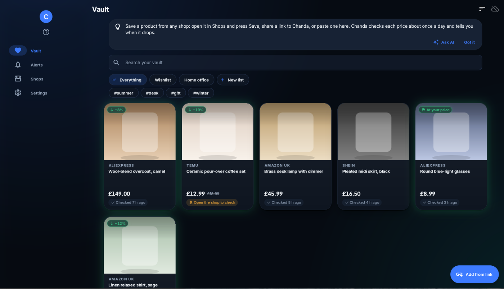
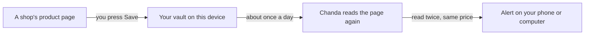

<div align="center">


# Chanda

<h4>Keep everything you want to buy in one private place, and hear when the price really drops.</h4>


[](LICENSE)


[What it does](#-what-it-does) • [Get started](#-get-started) • [How it works](#-how-it-works) • [Your data](#-your-data) • [FAQ](#-faq) • [For developers](#%EF%B8%8F-for-developers)



</div>

Chanda is a shopping helper that works only for you. Save a product from any shop, and Chanda keeps an
eye on its price and tells you when it drops. It adds no affiliate tags and sells no data, and it reads
every price twice before it alerts you.

**Status: alpha.** The vault, price checks, alerts, search, price comparison, taste learning, similar
shops and try-on work. Some shops show prices only to a person in front of the screen, so Chanda checks
those only while it is open.

## ✨ What it does

- 💛 **One vault for every shop** – save from a link, the share menu, or the built-in browser, into lists
  with tags and notes.
- 📉 **Price history** – a chart of each price over time, with when it was last checked.
- 🔔 **Real drop alerts** – a target price, any drop, or back in stock, checked again before you are told.
- 🔎 **Search everywhere at once** – one search box looks in your vault and at several shops together.
  Type "black shirt under £30" and Chanda turns the colour and budget into filters you can tap off.
- ⚖️ **The best deal, with the reason** – Chanda finds the same product at other shops, asks you when it is
  not sure, and names the best one: "£4.20 less delivered than the next, rated 4.5 by 300".
- 📷 **Search with a photo** – take or pick a photo and Chanda names what it shows, finds things that look
  like it, and searches the shops for it. It runs on your device, with an optional download.
- ⭐ **Suggestions that learn your taste** – rate things with stars and *For you* suggests more like them,
  each with the reason. Turn it off, export it, or forget it at any time.
- 🏬 **Shops like yours** – shops that sell what you save at the prices you pay, with the facts they publish
  about themselves, and a button to add them to your search.
- 👓 **Try glasses on** – see glasses from your vault on a photo of your face, at their real size, sized from
  your eyes or the pupil distance you type. It says how sure it is, and says so plainly when it cannot fit
  them. It never changes your photo. It runs on your device, with an optional download.
- 👕 **Try clothes on** – see a top, dress or skirt from your vault on a photo of your whole body. The garment
  is stretched to your shape, never you to the garment, and Chanda will not show a picture that makes you
  look slimmer. A size note puts your measurements on the shop's size chart. With your own key for an AI
  try-on service, you can also ask for a more lifelike picture.
- 🧠 **Smarter search, if you want it** – an optional download that finds things by meaning ("specs" finds
  reading glasses). It runs on your device.
- 🧾 **What you will really pay** – the delivered total in pounds, with UK VAT and import duty for
  goods sent from abroad.
- 🛒 **Buy inside the app** – open the shop in Chanda's browser and check out with your own account.
- 🔒 **Payment pages are left alone** – Chanda never reads sign-in or payment pages and never stores card details.
- 🎨 **A calm, fluid look** – soft depth, glows and gentle motion, with light and dark themes.

## 🚀 Get started

Chanda is an alpha: it works, but expect rough edges. Downloads are on the
[Releases page](https://github.com/sudharamachandranrajeev/chanda-shopping-assistant/releases).

**Android**

1. On your phone, open the Releases page and download `Chanda-<version>-android-arm64-v8a.apk`.
   Almost every phone from the last ten years wants this one. Very old phones want `armeabi-v7a`.
2. Open the downloaded file. If Android asks, allow your browser to install apps.
3. Open Chanda and allow notifications, so it can tell you when a price drops.

**Windows**

1. Download `Chanda-<version>-windows-x64-setup.exe` and run it.
2. Windows may say it protected your PC, because the installer is not signed. Choose *More info*, then
   *Run anyway*.
3. Chanda is in the Start menu. No installer wanted? Use the `portable.zip` and run `chanda.exe`.

**Linux**

There are two Linux downloads:

- `Chanda-<version>-linux-x64-wpe.tar.gz` has the in-app browser: shops, sign-ins and the *needs you*
  tabs open inside Chanda. It needs WPE WebKit 2.52 or later, which Arch Linux, Omarchy and other
  Arch-based systems have (the package is called `wpewebkit`).
- `Chanda-<version>-linux-x64.tar.gz` runs on most other distributions. It has no in-app browser, so
  shops open in your normal browser. Search still reads shops that offer a plain search.

1. You need GTK 3, libsecret and a keyring (GNOME Keyring or KWallet). Most desktops have them.
2. Download the file that fits your system from the Releases page and unpack it.
3. In the unpacked folder, run `./install.sh` to add Chanda to your app menu. No root needed.

**Arch Linux or Omarchy, from the terminal**

1. Install what Chanda needs (Omarchy already has most of it):

   ```bash
   sudo pacman -S --needed gtk3 libsecret wpewebkit gnome-keyring curl
   ```

2. Download the newest Linux release with the in-app browser, and its checksums, and check them:

   ```bash
   cd "$(mktemp -d)"
   url=$(curl -s https://api.github.com/repos/sudharamachandranrajeev/chanda-shopping-assistant/releases \
     | grep -o 'https://[^"]*linux-x64-wpe\.tar\.gz' | head -n 1)
   echo "${url:-No download with the in-app browser yet: use the steps under Linux above.}"
   curl -LO "$url"
   curl -LO "${url%/*}/SHA256SUMS.txt"
   sha256sum -c --ignore-missing SHA256SUMS.txt
   ```

   The check should say `OK` for one file.

3. Unpack it and add Chanda to your app menu (no root needed):

   ```bash
   tar xzf Chanda-*-linux-x64-wpe.tar.gz
   ./chanda-*-linux-x64-wpe/install.sh
   ```

4. Open Chanda from your app menu (on Omarchy, press <kbd>Super</kbd> + <kbd>Space</kbd> and type
   "Chanda"), or run `chanda` in a terminal. If `chanda` is not found, add `~/.local/bin` to your `PATH`.
5. To update, repeat steps 2 and 3. To remove it, run `./chanda-*-linux-x64-wpe/install.sh --uninstall`
   from the folder you unpacked into. Your data stays.

Each release lists SHA-256 checksums in `SHA256SUMS.txt`, if you want to check your download.

## 🧭 How it works



- Chanda reads what the page itself says: the shop's product details first, then what is drawn on screen.
  If the page gives no price at all, Chanda reads it off the screen with its own built-in text recognition,
  on your device. No AI plan or account is needed for this.
- If you add your own Anthropic API key in Settings, a **Read with AI** button can fill in a name and price
  Chanda was unsure of. You always check them before saving.
- Some shops only show search results to a person. For those, Chanda shows the shop's own page as a tab
  inside Search, marked *needs you*. You pass the check or sign in there; Chanda adds the products it can
  see to the same results, and never reads sign-in or payment pages.
- A shop that shows a "prove you are human" check is never worked around. Chanda asks you to open it instead.
- Checks are spread out and slow, one page at a time, so no shop is hammered.
- Your star ratings, and what you save and buy, make a small taste model on your device. It suggests and
  sorts by what you like. It never uses your age or gender.

## 🔒 Your data

- Your vault lives in an encrypted database on your device.
- Chanda contacts only the shops you save from or search, and a free exchange-rate service. If you turn on
  Brahma sync, it also contacts your own sync server.
- Smarter search downloads its model once, from Hugging Face, only if you ask. After that your searches
  stay on your device.
- Read with AI sends a product page's text to Anthropic, with your own key, only when you press the button.
  Sign-in and payment pages are never sent. Your key stays on this device and is never synced.
- Picture search downloads its model once, from Hugging Face, only if you ask. Your photos stay on your
  device. To compare looks, Chanda fetches the pictures of things you saved or found, saying it is Chanda.
- When you check a shop, Chanda reads its home page and asks the registry for its web address when it was
  first registered.
- Try-on downloads its models once, from Hugging Face, only if you ask. Your face and body photos, sizes and
  pupil distance are kept only after you agree, only on this device, and are never synced or sent anywhere.
  *Delete my photos and sizes* in Settings removes them from the database file too.
- AI try-on is off unless you add your own key for FASHN, fal or Gemini. Your body photo and the garment's
  picture go to that service only when you press **Try with AI**, after you have agreed to what it keeps and
  charges. Gemini keys are used only on a paid plan, because Google may use what is sent on a free key.
- To find a size chart, Chanda reads the product's page again. The chart is kept on this device and
  forgotten when you delete the item.
- Your ratings sync with your vault. Settings can export them to a file, or forget them all.
- Delete an item and its saved pictures go with it.

## ❓ FAQ

<details>
<summary>Why does an item say "Open the shop to check"?</summary>

That shop showed a check page or hid its price from an automatic visit. Open it from the Shops page,
finish any check it shows, and press **Update price**.
</details>

<details>
<summary>Why does Chanda suggest those shops?</summary>

They sell the kinds of things you save, at about the prices you pay. They come from a short list kept
with Chanda, and no shop pays to be on it. Press the check button to see what a shop publishes about
itself before you buy there.
</details>

<details>
<summary>Do I need an AI plan to read prices off the screen?</summary>

No. Chanda has its own text recognition built in and it runs on your device. Read with AI is only an
extra, for when you add your own key.
</details>

<details>
<summary>Why does try-on say "Cannot fit this photo"?</summary>

Chanda draws clothes only when it can do it fairly. It needs one person, standing and facing the camera,
the whole body in the photo, and a picture of the garment on its own, laid flat or hung straight. If the
drawn garment would make you look narrower anywhere, it is not shown. The message says what to change.
Try another product picture with the buttons under the photo.
</details>

<details>
<summary>Does Chanda earn money when I buy?</summary>

No. It removes tracking and affiliate tags from the links you save, and never adds its own.
</details>

## 🛠️ For developers

<details>
<summary>Build from source</summary>

1. Install [Flutter](https://docs.flutter.dev/get-started/install) 3.47 or newer.
2. On Linux, install WPE WebKit 2.52 or newer for the in-app browser (`wpewebkit` on Arch).
3. Run `flutter pub get`, then `flutter run`.
4. Run the tests with `flutter test` (the browser-script tests need Chromium and skip without it).
5. To test the smarter-search model itself, download it into a folder and run
   `flutter test integration_test/embedder_test.dart -d linux --dart-define=MODEL_DIR=/that/folder`.
6. To test the picture model, download it into a folder and run
   `flutter test integration_test/pictures_test.dart -d linux --dart-define=PICTURE_DIR=/that/folder`.
7. To test try-on with the real models, download them into a folder and run
   `flutter test integration_test/tryon_test.dart -d linux --dart-define=TRYON_DIR=/that/folder` and
   `flutter test integration_test/clothes_test.dart -d linux --dart-define=TRYON_DIR=/that/folder`. Each
   file's header lists the optional pictures it can also check.
8. For a phone, build with `flutter build apk --split-per-abi`: one APK per processor type is much smaller.

`packages/flutter_inappwebview_linux` is a patched copy of the Linux web view plugin; its README lists
the changes.
</details>

## License

[MIT](LICENSE)

> GitHub [@sudharamachandranrajeev](https://github.com/sudharamachandranrajeev)
