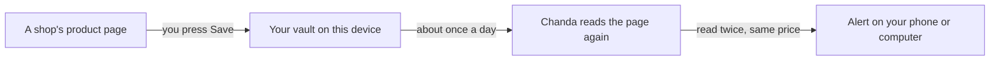

# Chanda

<h4>Keep everything you want to buy in one private place, and hear when the price really drops.</h4>

[What it does](#-what-it-does) • [Get started](#-get-started) • [How it works](#-how-it-works) • [Your data](#-your-data) • [FAQ](#-faq) • [For developers](#%EF%B8%8F-for-developers)

Chanda is a shopping helper that works only for you. Save a product from any shop, and Chanda keeps an
eye on its price and tells you when it drops. It adds no affiliate tags and sells no data, and it reads
every price twice before it alerts you.

**Status: alpha.** The vault, price checks, alerts, search and price comparison work. Taste learning,
similar shops and virtual try-on are still to come. Some shops show prices only to a person in front of the screen, so
Chanda checks those only while it is open.

## ✨ What it does

- 💛 **One vault for every shop** – save from a link, the share menu, or the built-in browser, into lists
  with tags and notes.
- 📉 **Price history** – a chart of each price over time, with when it was last checked.
- 🔔 **Real drop alerts** – a target price, any drop, or back in stock, checked again before you are told.
- 🔎 **Search everywhere at once** – one search box looks in your vault and at several shops together.
  Type "black shirt under £30" and Chanda turns the colour and budget into filters you can tap off.
- ⚖️ **The best deal, with the reason** – Chanda finds the same product at other shops, asks you when it is
  not sure, and names the best one: "£4.20 less delivered than the next, rated 4.5 by 300".
- 🧠 **Smarter search, if you want it** – an optional download that finds things by meaning ("specs" finds
  reading glasses). It runs on your device.
- 🧾 **What you will really pay** – the delivered total in pounds, with UK VAT and import duty for
  goods sent from abroad.
- 🛒 **Buy inside the app** – open the shop in Chanda's browser and check out with your own account.
- 🔒 **Payment pages are left alone** – Chanda never reads sign-in or payment pages and never stores card details.
- 🎨 **A calm, fluid look** – soft depth, glows and gentle motion, with light and dark themes.

## 🚀 Get started

There is no download yet: the first release comes when the remaining phases are done. Until then you
can build Chanda yourself (see [For developers](#%EF%B8%8F-for-developers)).

## 🧭 How it works

- Chanda reads what the page itself says: the shop's product details first, then what is drawn on screen.
  On Android, if the page gives no price at all, Chanda reads it off the screen, on the phone itself.
- If you add your own Anthropic API key in Settings, a **Read with AI** button can fill in a name and price
  Chanda was unsure of. You always check them before saving.
- Some shops only show search results to a person. For those, Chanda opens the search in its browser and
  you press **Add these results**.
- A shop that shows a "prove you are human" check is never worked around. Chanda asks you to open it instead.
- Checks are spread out and slow, one page at a time, so no shop is hammered.

## 🔒 Your data

- Your vault lives in an encrypted database on your device.
- Chanda contacts only the shops you save from or search, and a free exchange-rate service. If you turn on
  Brahma sync, it also contacts your own sync server.
- Smarter search downloads its model once, from Hugging Face, only if you ask. After that your searches
  stay on your device.
- Read with AI sends a product page's text to Anthropic, with your own key, only when you press the button.
  Sign-in and payment pages are never sent. Your key stays on this device and is never synced.
- Delete an item and its saved pictures go with it.

## ❓ FAQ

Why does an item say "Open the shop to check"?

That shop showed a check page or hid its price from an automatic visit. Open it from the Shops page,
finish any check it shows, and press **Update price**.

Does Chanda earn money when I buy?

No. It removes tracking and affiliate tags from the links you save, and never adds its own.

## 🛠️ For developers

Build from source

1. Install [Flutter](https://docs.flutter.dev/get-started/install) 3.47 or newer.
2. On Linux, install WPE WebKit 2.52 or newer for the in-app browser (`wpewebkit` on Arch).
3. Run `flutter pub get`, then `flutter run`.
4. Run the tests with `flutter test` (the browser-script tests need Chromium and skip without it).
5. To test the smarter-search model itself, download it into a folder and run
   `flutter test integration_test/embedder_test.dart -d linux --dart-define=MODEL_DIR=/that/folder`.
6. For a phone, build with `flutter build apk --split-per-abi`: one APK per processor type is much smaller.

`packages/flutter_inappwebview_linux` is a patched copy of the Linux web view plugin; its README lists
the changes.

## License

[MIT](LICENSE)

> GitHub [@sudharamachandranrajeev](https://github.com/sudharamachandranrajeev)
